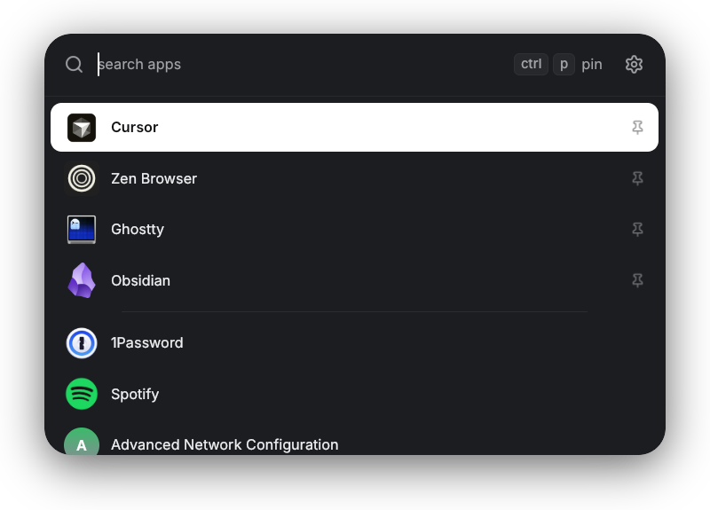

# launcher

XDG app launcher for Linux. Lists `.desktop` apps, filter by name, Enter or click to launch, Escape to quit.



Built with [Rune](https://github.com/anomalyco/rune). Borderless, always-on-top, transparent window with a centred card. A click outside the card closes it. It also closes on focus loss, so with focus-follows-mouse, use the `stay_focused` rule below, or a pointer move closes it.

## Keys

| Key | Action |
|---|---|
| Type | Filter apps by name |
| ↑ / ↓ | Move selection by row (keeps column in grid) |
| ← / → | Move selection in grid; caret in list |
| Enter / click | Launch selected app |
| Escape | Close (or leave settings) |
| Ctrl+, | Toggle layout settings |
| Ctrl+P | Pin / unpin selected app |

Empty query shows pinned apps first, then most-launched, then alphabetical. Search covers every app.

Apps with `Terminal=true` open in `$TERMINAL`, or in `xdg-terminal-exec` when `$TERMINAL` is not set. The terminal must accept `-e command`. Launch uses the Desktop Entry `Exec` argv (no shell); a failed start keeps the window open and shows the error.

## Install

```bash
nix build
./result/bin/launcher
```

Bind that binary to a compositor shortcut. Wayland app_id / X11 class is `sh.bzn.launcher`.

### Hyprland

The window is transparent and draws its own card, corners and shadow. Turn off Hyprland's versions so they do not frame the empty margin. The window does not resize, so let Hyprland float and centre it.

```lua
hl.window_rule({
  ["match"] = { ["class"] = "^(sh\\.bzn\\.launcher)$" },
  ["name"] = "launcher",
  ["float"] = true,         -- tiling would stretch the fixed-size window
  ["center"] = true,
  ["pin"] = true,           -- show on every workspace
  ["stay_focused"] = true,  -- focus-follows-mouse cannot move focus away (focus loss closes it)
  ["border_size"] = 0,      -- the card draws its own edge
  ["rounding"] = 0,         -- the card draws its own corners
  ["no_shadow"] = true,     -- the card draws its own shadow
  ["no_blur"] = true,       -- blur would fill the transparent margin
})
```

Set `TERMINAL` in the bind if `xdg-terminal-exec` is not installed. Otherwise `Terminal=true` apps do not start:

```lua
hl.bind("SUPER + SPACE", hl.dsp.exec_cmd("env TERMINAL=ghostty launcher"))
```

## Config

| Path | Purpose |
|---|---|
| `$XDG_CONFIG_HOME/sh.bzn.launcher/settings` | Layout (`key=value`) |
| `$XDG_CONFIG_HOME/sh.bzn.launcher/pinned` | Pinned `.desktop` filenames, one per line |
| `$XDG_STATE_HOME/sh.bzn.launcher/usage` | Launch counts |

Settings panel (gear / Ctrl+,): list vs grid, icon size, name size, show/hide names, compact/tall, corner style, shadow.

## Develop

Prerequisites: [Nix](https://nixos.org/download/) and [devenv](https://devenv.sh/getting-started/) (`nix profile install nixpkgs#devenv`).

`devenv shell` provides Rust, Cargo, rustfmt, clippy, ripgrep (`rg`), and fd (`fd`), plus the same native libraries the package links and dlopens (`deps.nix`). Wayland or X11 is required to open the window.

```bash
devenv shell
cargo build
cargo test
cargo run
rg --version
fd --version
```

`devenv test` runs `cargo fmt --all -- --check`, clippy, and `cargo test`:

```bash
devenv test
```

`cargo fmt --check` fails on the current `src/main.rs`. Rustfmt would reflow that dense file, so the source was left as it is. Clippy and `cargo test` pass. Clippy prints two existing warnings.

`nix develop` is the flake shell (Cargo and the package's link libraries). `nix build` still produces the wrapped binary for `x86_64-linux` and `aarch64-linux`:

```bash
nix build
./result/bin/launcher
```

Runtime wrap in the flake puts Vulkan/Wayland/X11 libs on `LD_LIBRARY_PATH` — keep that if you change the package. The pinned nixpkgs tarball in `devenv.yaml` is the revision locked in `flake.lock`.

---

> [!Note]
>
> | | [AI:X](http://0rwx.com) - Written with Claude & Cursor, but Human verified |
> |------|-----|
